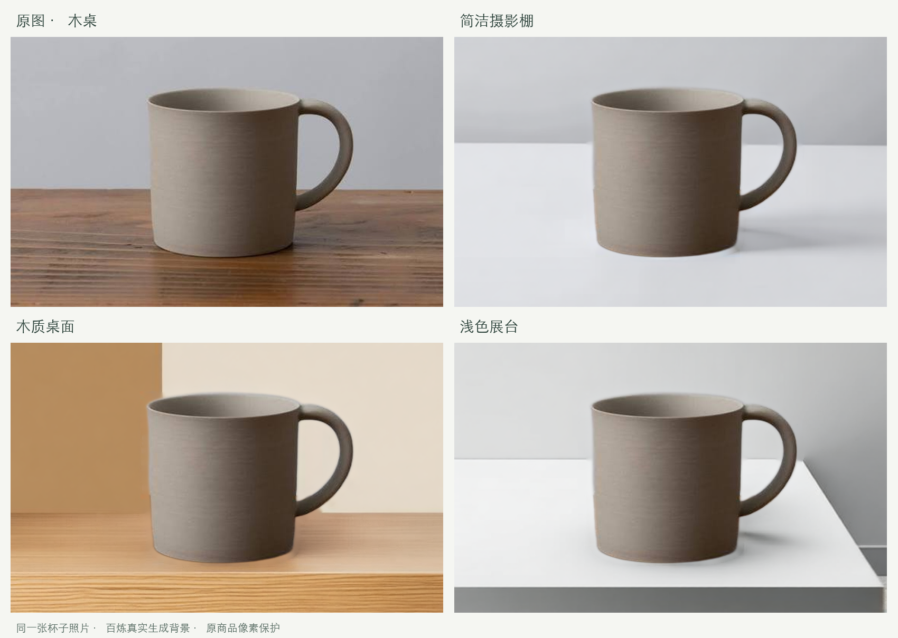

# FRAME / AI Product Studio

**AI 商品图换背景助手：换一个场景，保留商品本身。**

一个可在本地运行的 Python + Streamlit 项目。通过阿里云百炼真实图像编辑 API 生成背景，结合本地商品分割、编辑蒙版和原像素合成，解决整图编辑中“背景没怎么变、商品却被改了”的问题。



上图是同一张杯子照片的 **3 次真实云端生成结果**，分别为简洁摄影棚、木质桌面和浅色展台。样例用于展示，页面生成流程始终调用真实 API。

[架构与实现](docs/ARCHITECTURE.md) · [项目讲述与演示](docs/PORTFOLIO.md) · [验证记录](VERIFICATION.md) · [API 接入依据](API_NOTES.md)

## 项目亮点

| 关注点 | 实现 |
| --- | --- |
| 商品一致性 | 自动识别商品轮廓，用黑白蒙版限制背景编辑，再合成尺寸适配后的原商品像素 |
| 背景可控 | 三组独立场景指令，明确承托面、材质、光线与接触阴影 |
| 可检查的处理过程 | 原图预览、商品轮廓预览、编辑指令、任务状态和结果并排对比 |
| 可恢复的生成流程 | 分离任务提交、轮询、下载与合成；查询或下载中断时优先续用原任务 |
| 可复现的验证 | 60 项自动化测试；另用同一张真实商品图完成三种风格的端到端验证 |

技术栈：**Python · Streamlit · 阿里云百炼 HTTP API · rembg / ONNX Runtime · Pillow · OpenCV**。

## 快速运行

需要 **Python 3.11–3.13**，推荐 3.13；本地分割依赖目前不支持 Python 3.14。已验证环境为 macOS + Python 3.13.11。

下载或克隆仓库，进入项目目录后执行：

```bash
python3.13 -m venv .venv
source .venv/bin/activate
python -m pip install -r requirements.txt
cp .env.example .env
```

用本地文本编辑器打开 `.env`，填写北京地域的 `DASHSCOPE_API_KEY`，然后启动：

```bash
python -m streamlit run app.py
```

浏览器访问终端显示的地址，通常为 `http://localhost:8501`。端口被占用时可加 `--server.port 8502`。

Windows 可使用 `py -3.13 -m venv .venv` 创建环境，通过 `.venv\Scripts\activate` 激活，并将 `.env.example` 复制为 `.env`。

### 环境配置

| 变量 | 默认值 / 说明 |
| --- | --- |
| `DASHSCOPE_API_KEY` | 必填：北京地域百炼 API Key，需开通模型权限并确认额度 |
| `DASHSCOPE_MODEL` | `wanx2.1-imageedit`；当前适配器只支持这个模型的显式蒙版协议 |
| `DASHSCOPE_BASE_URL` | `https://dashscope.aliyuncs.com`；也支持北京业务空间专属域名 |
| `POLL_INTERVAL_SECONDS` | `2`，任务查询间隔 |
| `TASK_TIMEOUT_SECONDS` | `180`，本轮等待上限，超时可继续查询原任务 |
| `REQUEST_TIMEOUT_SECONDS` | `30`，单次 HTTP 请求超时 |
| `U2NET_HOME` | 可选，本地分割模型缓存目录；默认使用项目 `work/models` |

密钥只从本地 `.env` 或进程环境变量读取，进程环境变量优先；网页没有密钥输入框。`.env` 和模型缓存不提交仓库。北京业务空间域名示例为 `https://你的WorkspaceId.cn-beijing.maas.aliyuncs.com`，不要附加 `/api/v1`。

自动识别首次使用会下载 `isnet-general-use` 模型，约 170 MB，随后在本机 CPU 上运行；不需要额外的分割 API Key。

## 使用方式

1. 上传一张不超过 10 MB 的 JPG/PNG，查看原图。
2. 选择「简洁摄影棚」「木质桌面」或「浅色展台」。
3. 点击「识别商品轮廓」，确认杯把、孔洞、边缘等区域识别正确。
4. 点击「生成」，查看任务状态和耗时，完成后对照原图并下载 PNG。
5. 失败时直接重试，上传图片、风格和轮廓仍保留。

轮廓不准时，可在「商品轮廓」中上传修正的 PNG 蒙版：**白色保留商品、黑色替换背景**；尺寸与方向须对应校正方向后的原图。页面会转换成百炼要求的相反语义：**纯黑保护商品、纯白编辑背景**。有效透明 PNG 可以直接使用其透明通道，无需自动分割。

## 从“指令换背景”到“商品保护”

旧版使用整图 `description_edit`，仅靠文字描述要求保留商品。实际样例出现过桌面纹理仍在、杯子形状却被改变的情况。

新版将任务拆成四步：

```text
商品分割 → 背景蒙版局部重绘 → 轮廓外重影清理 → 原商品像素合成
```

百炼通过 `description_edit_with_mask` 生成新背景；本地保留原商品的颜色、纹理和几何位置，并用 alpha 混合边缘。局部重绘不发送 `strength`，因为官方没有将它列为该模式参数。模型选择与请求结构见 [API_NOTES.md](API_NOTES.md)。

这也是项目的主要工程取舍：把可确定的像素保留交给图像处理，把场景生成交给模型。

## 验证

```bash
# 本地测试：云端边界使用模拟响应，不创建付费任务
python -m unittest discover -s tests -v

# 单张真实调用：每次执行会创建一个任务，按百炼规则计费
python smoke_live.py product.jpg --style 浅色展台 --output result.png
# 可选参数：--mask product-mask.png
```

2026-11-19 的验证结果：**60 项测试通过，3 种风格真实生成成功**。三张输出在实心商品蒙版内，相对尺寸适配后的输入，RGB 通道最大差值均为 0；这说明对应区域的原像素保留，不等于所有商品都已通过视觉验收。

真实样图为一只没有文字或 Logo 的杯子。文字像素保留由合成测试验证，尚未覆盖各类真实包装。详细方法、测试范围与限制见 [VERIFICATION.md](VERIFICATION.md)。

## 项目结构

```text
app.py                 Streamlit 页面、会话状态和下载
ui.py                  页面样式
images.py              文件校验、方向校正和尺寸适配
protection.py          分割、蒙版、重影清理和原像素合成
bailian.py             真实 HTTP 提交、查询和结果下载
workflow.py            任务流程、错误处理和重试
prompts.py / config.py  背景指令与服务端配置
smoke_live.py           单张真实调用脚本
tests/                 页面、接口、图片处理与重试测试
examples/              真实样例和对比图
docs/                  架构说明与项目展示材料
```

## 当前范围

这是以本地使用和工程展示为目标的应用，当前没有账号系统、数据库或后台任务队列。网页任务保存在当前 Streamlit 会话，关闭会话或重启进程后不会自动恢复；命令行脚本每次执行都会提交新任务，已有任务请保留 ID 查询。

商品保留依赖分割轮廓。透明材质、细线、反光和复杂背景可能需要修正蒙版；窄边缘清理可能平滑局部纹理，商品原有反射也未必与新背景一致。小图会等比放大，但不会凭空恢复高清细节。模型名称可配置，但接入其他协议需要新增适配，不能只改成 2.5/2.7 的模型名。

## 官方参考

- [阿里云百炼：万相图像编辑 API](https://help.aliyun.com/zh/model-studio/wanx-image-edit-api-reference)
- [万相 2.1 使用指南](https://help.aliyun.com/zh/model-studio/wanx-image-edit)
- [获取 API Key](https://help.aliyun.com/zh/model-studio/get-api-key)
- [rembg 官方项目](https://github.com/danielgatis/rembg)
