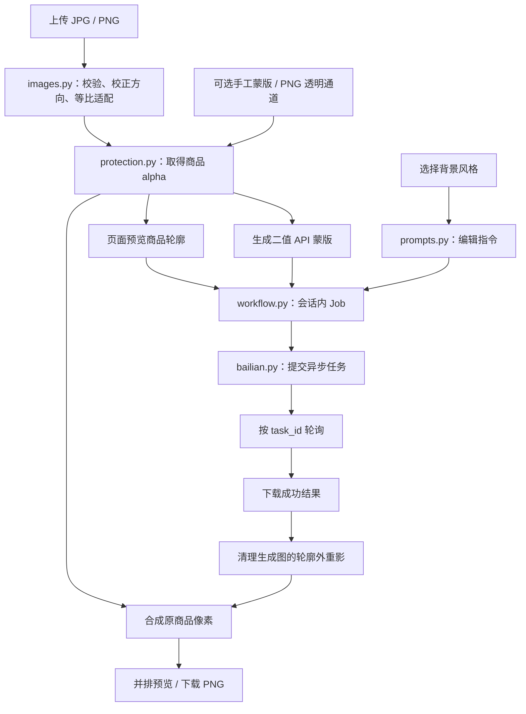

# 架构与实现

[返回项目首页](../README.md)

FRAME 将本地可确定的商品保留与云端场景生成分开。Streamlit 负责交互和会话状态；本地分割产生商品 alpha 与背景编辑蒙版；百炼只接收一张商品图、一张二值蒙版和所选背景指令；结果下载后再合成原商品。

## 数据流

## 图像与蒙版约定

`ProductImage` 保存原始上传数据和生成用图。原图用于页面对照；生成用图经 EXIF 方向校正、等比缩放，必要时居中补边，不裁切商品。当前 API 的宽高要求均为 512–4096 像素，上传上限为 10 MB。

`PreparedProduct` 的三个图层必须对齐：

| 字段 | 内容 | 用途 |
| --- | --- | --- |
| `source_png` | 尺寸适配后的商品 RGB 图片 | 保存最终合成所需的原商品像素 |
| `alpha_png` | 白色商品、黑色背景，允许软边缘 | 本地轮廓预览与透明度合成 |
| `mask_png` | 纯黑商品、纯白背景的 RGB 二值图 | 指定百炼局部重绘区域 |

商品 alpha 的来源按顺序选择：手工蒙版、PNG 有效透明通道、`isnet-general-use` 本地分割。手工蒙版及原图透明通道复用图片的缩放和补边坐标；更换商品会隔离原来的蒙版上传组件。无法获得有效商品与背景分区时，流程停在本地，不退回整图重绘。

商品 alpha 中大于等于 250 的值归一为 255，小于等于 5 的值归一为 0。API 蒙版将剩余的所有商品像素设为纯黑，背景设为纯白；保留杯把孔洞这样的背景区域。API 蒙版不进行灰度羽化，软边缘只用于最终合成。

## 异步接口边界

`BailianClient.submit()` 使用 `description_edit_with_mask` 和 Base64 图片提交一个任务，`parameters` 为 `n=1`、`watermark=false`。它检查图片与蒙版尺寸、黑白语义、字节大小和提示词长度。高分辨率 JPG 转 PNG 后可能超过 10 MB，此时仅压缩 API 传输副本，保留本地 `source_png` 用于最终合成。

任务提交返回 ID 后，`run_job()` 处理 `PENDING`、`RUNNING`、`SUCCEEDED`、`FAILED`、`CANCELED`、`UNKNOWN` 等状态。HTTP 超时和轮询等待上限独立配置；UI 展示阶段、累计处理耗时和必要的错误信息。当前协议及官方文档链接见 [API_NOTES.md](../API_NOTES.md)。

## 失败恢复

| 发生位置 | 当前保存的内容 | 用户点击重试后的动作 |
| --- | --- | --- |
| 本地商品识别失败 | 上传图片、风格 | 重新识别，或使用修正蒙版 |
| 提交失败、没有任务 ID | 商品图、轮廓、风格 | 再次提交；提交超时会明确提示云端可能已经受理 |
| 查询断网或等待超时 | `task_id` | 查询同一个任务 |
| 图片下载失败 | `task_id`、结果 URL | 下载原任务结果 |
| 本地合成失败 | 已下载的 `raw_result` | 复用图片重新合成 |
| 云端失败、任务取消或结果过期 | 原上传与轮廓 | 显式重试时清理旧任务信息并提交新任务 |

提交请求没有自动重发。没有拿到任务 ID 时，应用无法证明云端未受理，因此不能承诺严格的幂等提交。查询和下载重试则通过保留任务状态减少重复生成。

`Job` 同时保存提交时的模型和服务地址，续查时若配置改变会停止并提示恢复。状态位于 `st.session_state`，没有落入数据库；不是跨进程可恢复的后台队列。

## 合成与边缘处理

生成图可能把商品轮廓向外延伸几个像素，即使合成原商品，外侧仍会出现重影。`compose_result()` 先将生成背景对齐到输入尺寸，再对商品区域及外围窄环做 OpenCV 局部修补；被修补的商品内部随后由原商品覆盖。商品最低点更外侧的背景保留，以减少接触阴影被清除的情况。

最终使用 alpha 合成：`结果 = 原商品 × alpha + 处理后的背景 × (1 − alpha)`。在 alpha 为 255 的区域，输出直接取原商品 RGB；软边缘允许混合。这里的“原商品”指尺寸适配后的输入，不是未缩放的上传文件。外围修补可能平滑局部背景纹理，无法代替正确的分割。

## 配置与数据范围

- API Key 从服务器环境或本地 `.env` 读取，不进入网页控件；配置对象的字符串表示不包含密钥。
- 客户端只接受当前实现的模型及百炼北京官方域名，避免把其他模型名误套进旧协议。
- 鉴权头只用于百炼 API 请求，结果下载不携带该头；服务错误信息会隐藏已知 API Key。
- 自动分割在本机 CPU 执行；商品图片、蒙版和指令在生成时传给百炼。图片不会因为分割而上传到另一个云服务。
- 生成结果在当前会话内保存，用户可主动下载。模型缓存在项目 `work/models`，该目录不纳入版本控制。

## 验证层次与后续方向

测试分别覆盖图片输入、蒙版语义与像素保留、HTTP 协议、工作流重试，以及 Streamlit 控件交互。真实测试另外验证了同一张杯图的三种背景，避免将模拟接口测试等同于效果验收。具体结果见 [VERIFICATION.md](../VERIFICATION.md)。

如果继续开发，优先事项是建立多种材质的效果样本集、提供更方便的蒙版修正交互，以及将任务记录持久化。多模型适配、账号体系和批处理均尚未实现。
